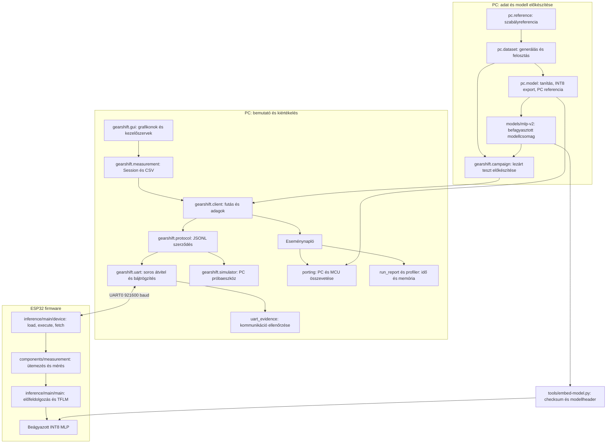

# ESP32 Edge AI bemutató: indítás, modulok és mérési forgatókönyv

Ez az útmutató a #9 bemutatójának operátori dokumentuma. Minden parancsot
Bash alatt, a repó gyökeréből futtass. A bemutató szintetikus menetszakaszok
szabályreferenciájának megtanulását, portolási helyességet és futási költséget
vizsgál. Járműves optimalitásra vagy energiamegtakarításra nincs eredmény.

## 1. Mit mutatunk be?

A PC rögzített, húszmintás ablakokat küld az ESP32-nek. A panel a saját,
befagyasztott INT8 MLP-jével downshift/hold/upshift döntést ad. A PC
megjeleníti az idő- és memóriaadatokat, összeveti a numerikus kimenetet a
PC-s referenciával, és CSV-be menti a futást. A modell döntése nem módosítja
a visszajátszott állapotot.

Két külön üzemmód van: élő megfigyelésben ablakonként érkezik válasz;
terhelésmérésben a panel előtöltött ablakokat ismétel, a mért végrehajtás alatt
UART nélkül, és csak a sorozat végén küldi az eredményt. A benchmark alatti
átmeneti grafikoncsend ezért elvárt.

## 2. Modulok és kapcsolatok



### Szabályreferencia és adatkészlet

A `pc/reference.py` validálja a nyers ablakot és determinisztikus címkét ad.
A `pc/dataset.py` konfigurációból reprodukálható meneteket generál,
menetenként osztja fel a train/validation/test részt, majd ablakokat képez.
A manifest, a lefedési kimutatás és a test-lock megakadályozza a lezárt teszt
észrevétlen átírását. Öt jel szerepel mintánként: sebesség, gázpedál,
emelkedő, fokozat és váltás óta eltelt idő. Húsz, 50 ms-onkénti minta
100 bemeneti értéket ad. Másik menetbe átnyúló ablak nem érvényes.
Részletek: [adat](dataset.md), [szabály](rule-reference.md),
[adatszerződés](data-contract.md).

### Tanítás, export és befagyasztás

A `pc/model.py` tanít, teljes INT8 TFLite-modellt exportál, és PC-s
referenciakimenetet számol. A kiválasztás validáció alapján történik.
A `gearshift/frozen_export.py` a befagyasztás és checksumok konzisztenciáját
ellenőrzi; a `gearshift/campaign.py` csak az engedélyezett végső értékelési
adatúton készíti elő a teljes lezárt tesztet. A `models/mlp-v2/` a kiválasztott
100 → 64 → 32 → 3 modell csomagja. A bemutatóhoz nem kell újratanítani.
Részletek: [modell](model.md).

### Kliens, protokoll és szállítás

A `gearshift/client.py` szervezi a kapcsolatot, az előtöltést, az execute/fetch
sorrendet és az eseménynaplót. A `gearshift/protocol.py` a verziózott JSON
Lines keretezés és érvényesség közös határa. A `gearshift/uart.py` POSIX
soros adaptert, határidős olvasást és nyers RX/TX-rögzítést biztosít.
Egy boot egy run_id-t fogad; hiba után nincs automatikus újraküldés.
A `gearshift/simulator.py` ugyanazt a szerződést szolgálja ki TCP-n vagy
beépített próbaeszközként, de döntése simulator_stub és minden eredménye
szimulált. Részletek: [kommunikáció](communication.md).

### Felület, munkamenet és export

A `gearshift/gui.py` PySide6/pyqtgraph felület, a `gearshift/measurement.py`
Session háttérszálon futtatja ugyanazt a klienst. A GUI megmutatja a futási
állapotot, státuszszámlálókat, MCU-időt és heapet. Az utolsó 2000 eredmény
látszik a grafikonon; az export az összes begyűjtött eseményt tartalmazza.
Az `event_json` CSV-oszlop a teljes eseményt megőrzi, a skalármezők a
keresést segítik. Részletek: [UI és CSV](measurement-ui.md).

### Firmware és mérőmodul

A `firmware/esp32/inference/main/device.cc` kezeli a korlátos bemeneti és
eredménypuffert, a load/execute/fetch műveleteket és a hibaválaszokat.
A `main.cc` kapcsolja hozzá az előfeldolgozást és a TensorFlow Lite Micro
futtatást. Érvényességvizsgálat után a skálázás
`[v/80, u, s/10, g-1, min(tau,10)/10]`; ezt a PC-vel egyező kvantálás követi.
A `reference_fc.cc` és az egyszeres kerekítés biztosítja a rögzített PC
aritmetikájával való egyezést. A `tools/embed-model.py` ellenőrzött modellből
generál firmware-headert.

A `firmware/esp32/components/measurement/` közös C++ modul ütemez,
időbélyegez és memóriát mintavételez. Nincs korlátlan feladatsor: foglalt
végrehajtó mellett missed keletkezik; késői befejezés late. A határidő az
eredeti időrácshoz tartozik. A `firmware/esp32/measurement/` külön mérési
próbaalkalmazás, a `bringup/` hivatalos kompatibilitási mintákat,
a `model_probe/` művelettámogatási próbát tartalmaz. A bemutató futó
alkalmazása az `inference/`. Részletek: [MCU-integráció](esp32-inference.md),
[mérőmodul](measurement-module.md).

### Elemzés és bizonyíték

A `gearshift/porting.py` külön ellenőrzi a bemeneti kódokat, a kimeneti
eltérést és az osztálydöntést; címkézett teljes tesztnél minőségi jelentést
is ad. A `gearshift/run_report.py` ellenőrzi a paneles eseményeket,
a `gearshift/profiler.py` az ütemezést és memóriát összesíti.
A `gearshift/uart_evidence.py` a nyers bájtfolyamot és a hoston megfigyelt
csendet ellenőrzi. A tesztek a `tests/`, a megőrzött kis bizonyítékok a
`docs/evidence/`, a nagy helyi állományok a `results/` alatt találhatók.

## 3. Előkészület és PC-s indítás

Szükséges: Linux grafikus munkamenet, Python 3.10+, venv/pip, USB-adatkábel,
ESP32 és soros hozzáférés. A modellkörnyezet külön függőségeit csak új
PC-referencia vagy teljes teszt előállításához kell telepíteni.

```bash
# Egyszeri rendszerfüggőségek Debian/Ubuntu alatt:
sudo apt-get update
sudo apt-get install python3-venv libegl1 libopengl0
python3 -m venv .venv-ui
.venv-ui/bin/python -m pip install -r requirements-ui.txt
.venv-ui/bin/python -m gearshift.gui
```

A Qt további platformfüggőségeket kérhet az adott asztali rendszeren.
Az `offscreen` mód automatizált ellenőrzésre szolgál; bemutatóhoz normál
asztali indítás kell. A felületen először a beépített szimulátorral
ellenőrizhető az indítás/export. Ez a próba nem hardveres teljesítményadat.
Qt nélküli gyors próba:

```bash
python3 -m gearshift.client --demo --mode live
python3 -m gearshift.client --demo --mode benchmark
```

## 4. SDK, panelazonosítás, firmware

Új gépen először az [ESP-IDF 5.5.1 telepítését](esp32-bringup.md#telepítés-debianon)
végezd el. Az alábbi SDK-útvonal a telepítési leírás alapértéke; ha más helyre
telepítetted, módosítsd. Külön terminálban dolgozz, aktív UI-venv nélkül.

```bash
export GEARSHIFT_SDK_ROOT="$HOME/gearshift-sdk"
export IDF_TOOLS_PATH="$GEARSHIFT_SDK_ROOT/tools"
. "$GEARSHIFT_SDK_ROOT/esp-idf/export.sh"
idf.py --version
# A tényleges porttal helyettesítsd:
export GEARSHIFT_PORT=/dev/ttyUSB0
python -m esptool --chip auto --port "$GEARSHIFT_PORT" chip_id
python -m esptool --chip auto --port "$GEARSHIFT_PORT" flash_id
(cd models/mlp-v2 && sha256sum -c SHA256SUMS)
bash firmware/esp32/inference/build.sh
idf.py -C firmware/esp32/inference -p "$GEARSHIFT_PORT" flash
```

Csak az azonosított ESP32/4 MiB célhoz használd ezt a konfigurációt.
A flash felülírja a panel programját. A jelenlegi defaults: 240 MHz CPU,
1000 Hz tick, CPU1 főfeladat, DIO/40 MHz/4 MiB flash, UART0 921600 baud,
TX1/RX3, nincs PSRAM vagy rádió. Meglévő sdkconfig felülírhatja a defaultsot;
a build után ellenőrizd az effektív értékeket:

```bash
rg 'CONFIG_(ESP_DEFAULT_CPU_FREQ_MHZ|FREERTOS_HZ|ESP_CONSOLE_UART|ESPTOOLPY_FLASH)' \
  firmware/esp32/inference/sdkconfig
```

115200-ra visszaálló baud esetén ellenőrizd a CUSTOM UART-választást is.
A portot egyszerre csak egy folyamat használhatja: zárd be a monitort.
EACCES esetén a [porthozzáférési lépéseket](esp32-bringup.md#folytatás-meglévő-környezetből)
kövesd. Minden új kliens- vagy GUI-futás előtt reseteld a panelt és várd meg
a boot végét. A következő segédscript ezt elvégzi.

## 5. Rögzített bemenet, CLI, PC-s összevetés

A 11 nyers referenciaablak előfeldolgozási ellenőrzésre, a négy benchmarkablak
ismételt terhelésre szolgál. Mindkettő Gitben megvan. SDK-terminálban:

```bash
# Mindig új könyvtárnevet adj; a script nem ír felül korábbi futást.
bash tools/run-esp32.sh live results/issue-9/live-01 \
  models/mlp-v2/reference-windows.jsonl
python3 -m gearshift.porting --reference models/mlp-v2/pc-reference.jsonl \
  --events results/issue-9/live-01/events.jsonl \
  --output results/issue-9/live-01/porting.json
python3 -m gearshift.run_report results/issue-9/live-01/events.jsonl \
  > results/issue-9/live-01/report.json
python3 -m gearshift.uart_evidence results/issue-9/live-01/wire \
  --output results/issue-9/live-01/uart-audit.json

bash tools/run-esp32.sh benchmark results/issue-9/benchmark-01 \
  docs/evidence/issue-7/benchmark-windows.jsonl
python3 -m gearshift.run_report results/issue-9/benchmark-01/events.jsonl \
  --require-benchmark > results/issue-9/benchmark-01/report.json
python3 -m gearshift.uart_evidence results/issue-9/benchmark-01/wire \
  --output results/issue-9/benchmark-01/uart-audit.json
```

A portolási kapu: azonos bemeneti INT8-kódok, azonos osztálydöntés,
elemenként legfeljebb 1 kimeneti INT8-kód eltérés. Hiányos futás nem sikeres.
A kis ablakminták nem helyettesítik a teljes tesztet. A teljes 71430 ablakos
minőségi kampány újrafuttatásának parancsai és adat-előfeltételei:
[lezárt teszt](esp32-inference.md#teljes-lezárt-teszt-és-külön-minőségi-jelentés).

## 6. GUI és CSV a valódi panellel

1. Reset és boot után indítsd a 3. szakasz UI-parancsát. Válaszd az ESP32
   UART eszközt, add meg a tényleges portot, a 921600 baudot és a modellazonosítót:
   `6d5ac8613d301ca06de2ca9a4cfbadf3cd40c7c75a7af419505eaa9fcbb25f79`.
2. Élő módban válaszd a `models/mlp-v2/reference-windows.jsonl` fájlt.
   Indíts, mutasd az eredményeket, az MCU-időgrafikont és a szabad heapet.
3. Befejezés után exportálj `results/issue-9/gui-live.csv` néven. A szülőkönyvtárat
   szükség esetén előbb hozd létre. Új futás lecseréli a memóriában az előzőt.
4. Új panelreset után válassz benchmarkot, a
   `docs/evidence/issue-7/benchmark-windows.jsonl` fájlt és mind a négy profilt.
   Indíts; a grafikon csak execute után, fetch közben frissül. A 120 s timeout
   a 100 s-os sorozatot is lefedi. A korábbi teljes hostfutás kb. 12 perc volt;
   a bemutató időkeretébe ezt előre számold bele.
5. A végén exportálj `results/issue-9/gui-benchmark.csv` néven.
   Ellenőrizd, hogy a futás teljes, eredete `simulated:false`.

CLI-eseményből is készíthető ugyanilyen visszaolvasható CSV:

```bash
.venv-ui/bin/python - <<'PY'
import json
from pathlib import Path
from gearshift.measurement import export_csv, read_csv, summary
source = Path('results/issue-9/benchmark-01/events.jsonl')
rows = [json.loads(line) for line in source.read_text().splitlines()]
assert rows[-1]['event'] == 'run_complete'
assert all(row['simulated'] is False for row in rows)
target = source.with_suffix('.csv')
export_csv(target, rows)
assert read_csv(target) == rows
print(summary(rows))
PY
```

## 7. Mérési elszámolás és eredmények

Profilonként T=D=10/20/50/100 ms, 100 bemelegítő + három 1000-es mért
sorozat: összesen 400 bemelegítő és 12000 mért feladat. A missed az 1000
része, nem pótlódik. A late egyszer számít nem teljesültnek. A feldolgozási
idő nem tartalmaz UART-átvitelt; az adagközi szünet külön mutató, hostvárakozást
is tartalmaz. A négy rögzített ablak ismétlése nem a teljes teszt időeloszlása.

Az alábbiak a 2026-10-23-i valódi paneles kampány megőrzött eredményei,
nem a jelen dokumentáció készítésekor újramért adatok.
Forrás: [részletes mérési napló](evidence/issue-7/verification.md),
[manifest](evidence/issue-7/manifest.json).

| Vizsgálat | Eredmény | Értelmezés |
| --- | --- | --- |
| Validációs makro-F1 | 0,7028518839 | A ≥0,95 cél nem teljesült; következő feladat #19 |
| Teljes lezárt teszt makro-F1 | 0,7606991312 | 71430 ablak, PC és MCU azonos; nincs visszahangolás |
| Portolási helyesség | 71430/71430; maximális eltérés 0 | Az elfogadott 1 kódos tűrésen belül |
| Négyprofilos benchmark | 12000/12000 mért ok; late/missed/failed=0 | 16 sorozat bemelegítéssel; rögzített munkakészlet |
| Inferencia medián | 0,833 ms minden profilban | Nem teljes MCU-feldolgozási idő |
| MCU-feldolgozás megfigyelt maximum | 2,865 / 2,869 / 2,870 / 2,864 ms | 10/20/50/100 ms sorrendben; nem bizonyított WCET |
| Sorozatok legkisebb szabad heapje | 136280 byte | Boot óta minimum külön: 81172 byte |
| Statikus arena / Device állapot | 32768 / 69792 byte | Eltérő mutatók; a Device puffer-részhalmazait ne add hozzá újra |

A korábbi hibás kerekítésű részfutás és a lehetetlen UART-szünetet tartalmazó
benchmark diagnosztikai bizonyíték maradt, nem része a sikeres végső futásnak.
A nyers UART-ellenőrzés hostoldali megfigyelés, nem logikai analizátoros mérés.
A teljes napló RAM-ban él exportig; összeomláskor elveszhet. A stop/timeout
részleges futás, nem sikeres lezárás, és nem állítható elő hiányzó mérés helyett nulla.

## 8. Rövid előadási forgatókönyv

| Időkeret | Teendő és mondanivaló |
| --- | --- |
| 0–2 perc | Cél és Mermaid-ábra: PC előkészít, ESP32 dönt, PC mér és összevet |
| 2–4 perc | Modellazonosító, rögzített nyers ablak, élő paneles GUI, idő és heap |
| 4–6 perc | CSV-export és PC-kimenet összevetése: minőség és portolási helyesség külön fogalom |
| 6–18 perc | Négyprofilos benchmark; execute közben nincs grafikonadat/UART, közben az ütemezés és memória értelmezése |
| 18–20 perc | 12400 rekord elszámolása, CSV, valódi eredmények, elmaradt F1-cél és #19 |

Rövidebb előadásnál a teljes benchmarkot előre futtasd le és azonosított
mentett eredményként mutasd be; a helyben futó élő paneles próbát külön
nevezd meg. Hiba esetén őrizd meg a részleges naplót, ellenőrizd a
port/baud/modellazonosítót, majd külön reset és új run_id mellett próbáld újra.

## 9. Átadás és reprodukálhatóság

A korábbi paneles firmware forrása `2d0fefed989e81cab008047c11cf7dc2ea07d95d`,
a végső benchmarkkliens/GUI forrása `aeef05f211183d70c912a6d86463b39b7483d2e0`.
A dokumentáció alapja a `f14440e265710b63559cdebfffbfb5b5da0707b0` merge.
Adatverzió: `ef6f8048efec22e32cc44fd4c58b08052359ab6880ee52c2257e3da59f27ba4a`.
Modellverzió: a 6. szakasz SHA-256 azonosítója. SDK: ESP-IDF 5.5.1,
esp-tflite-micro 1.3.5, esp-nn 1.1.1; a tényleges csomagzárak és sdkconfig a
[#7 bizonyítékcsomagjában](evidence/issue-7/verification.md) szerepelnek.

Új futásnál mentsd a `git rev-parse HEAD`, `git status --short`,
`python --version`, `idf.py --version` és `python -m pip freeze` kimenetét
az adott környezetből, a chip/flash-azonosítást, effektív sdkconfigot,
ELF/bin fájlokat, bemeneteket, teljes eseménynaplót, CSV-t, nyers UART-fájlokat
és az elemzések eredményét. Mindegyikhez rögzíts SHA-256-ot. A nagy
állományokat tartós, átadható helyen őrizd; a manifest önmagában nem pótolja őket.

A jelen ellenőrzés állapota és az issue-k lezárási döntése:
[#9 elfogadási napló](verification/issue-9.md).
