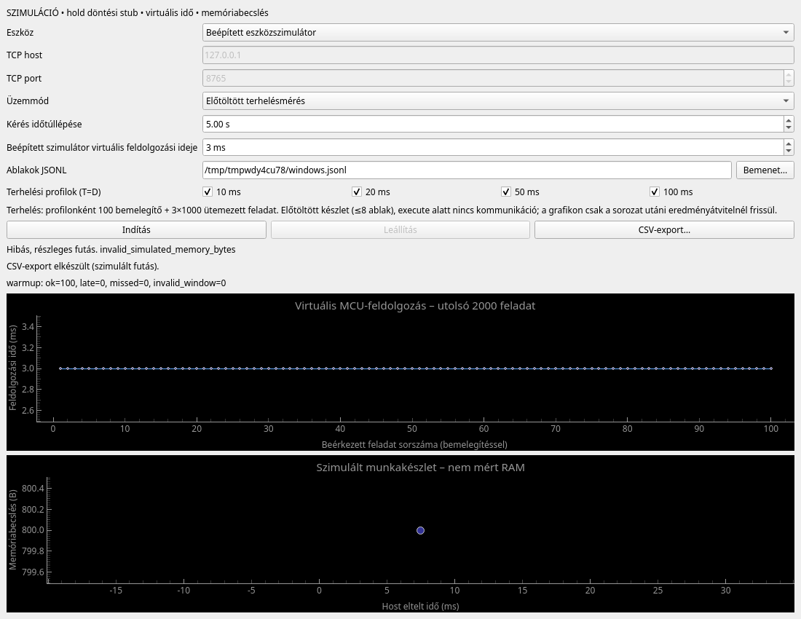

# #15 review-javítás: hibás memóriamező

A [P2 finding](https://github.com/poroszlay/edge-ai-gearshift/pull/15#issuecomment-6273429169)
ellenőrzése a PR meglévő `feat/issue-8-measurement-ui` branchén,
`a804839c1bb903ad24620c04630c75fa385a31d0` kiindulással, a meglévő
`/tmp/edge-ai-issue8` worktree-ben történt. Az issue-n nincs komment;
a PR-ben a vizsgálatkor egy általános findingkomment szerepelt, review és
inline review-komment nem. A findingot elfogadtuk; elutasított finding nincs.

## Reprodukció és javítás

A regressziós teszt a valódi `Device.handle` második execute ACK-jában
`simulated_memory_bytes="bad"` értéket küld. Így az első adag eredményei
már megvannak a hiba előtt. A teszt a tényleges widgeteket és Session/Client/
Wire adatútvonalat használja valódi socketpárral. A közvetlen poll-hívás
a grafikon kivételeit teszthibává teszi, nem hagyja őket Qt-visszahívásban
észrevétlenül megjelenni.

```bash
QT_QPA_PLATFORM=offscreen /tmp/issue8-venv/bin/python -m unittest discover \
  -s tests -p test_measurement_ui.py -k invalid_memory_ack -v
```

Javítás előtt mindkét módban a `memory_curve.setData` hívás ugyanazt a
`TypeError: ufunc 'isfinite' not supported` hibát dobta, mint a review-ban.
Javítás után a célzott próba sikeres (1 teszt, mindkét mód, 3,569 s).

Az ok: a nyers receive eseményből ellenőrizetlen mező került a grafikonba.
A kliens most az execute ACK memóriamezőjét a fetch előtt ellenőrzi:
kötelező, nemnegatív, véges számként ábrázolható egész byte-szám; bool sem
fogadható el. Hiba esetén failure és run_failed, run_complete nélkül.
A nyers ACK továbbra is a receive archívumban marad. A grafikon kizárólag
a kliens új, ellenőrzött batch_memory eseményét rajzolja, így a nyers ACK
naplózása és a háttérszál validációja közötti eseménysorrend sem okoz hibát.
A JSON Lines üzenetséma, ütemezés, firmware és szimulátor nem változott.

## Ellenőrzés

Linux x86_64, Python 3.13, PySide6 6.10.2, pyqtgraph 0.14.0, NumPy 2.5.4;
az eredeti izolált környezetben, engedélyezett helyi socketkommunikációval:

```bash
QT_QPA_PLATFORM=offscreen UI_EVIDENCE_DIR=/tmp/issue8-review-evidence \
  /tmp/issue8-venv/bin/python -m unittest discover -s tests -v
```

**43 teszt, 13,378 s, OK, nincs skip.** [Teljes napló](issue-8/review-tests.txt).

- Kliensregresszió: hiányzó mező, sztring, null, bool, negatív, tört,
  lista, objektum és lebegőpontos tartományon túli egész esetén kezelt hiba;
  a hibás nyers ACK és request_id megmarad, fetch és run_complete nincs.
- GUI-regresszió élő és benchmark módban: sikeres első adag, hibás második
  ACK, finished=True, látható hibakód, Indítás/CSV engedélyezett, Leállítás
  letiltva, ismételt poll kivétel nélkül. A CSV minden eseményt megőriz,
  a visszaolvasott számlálók azonosak a GUI-val. A hiba export után is látható.
- Hibás futás után mindkét módban sikeres újraindítás új run_id-val és újabb
  CSV-export, szimulációs jelöléssel.
- A meglévő indítás–leállítás–export–újraindítás, négyprofilos 12400 feladatos
  benchmark, kapcsolatvesztés, timeout, eszközhiba, lassított fájlműveletek és
  aszinkron bezárás tesztjei is sikeresek.



Ez ténylegesen renderelt offscreen Qt-kép a regressziós próba végéről.
A natív fájlválasztók visszatérését a teszt helyettesíti, a fájlműveletek
valósak. Natív asztali ablakkezelős és paneles/UART-os ellenőrzés nem történt.
Az eredmények továbbra is szimuláltak; a memóriában tárolt archívum és a
2000 pontos megjelenítési korlát változatlan. A finding javításának nincs
ismert nyitott akadálya. Review-thread lezárása nem történt.
