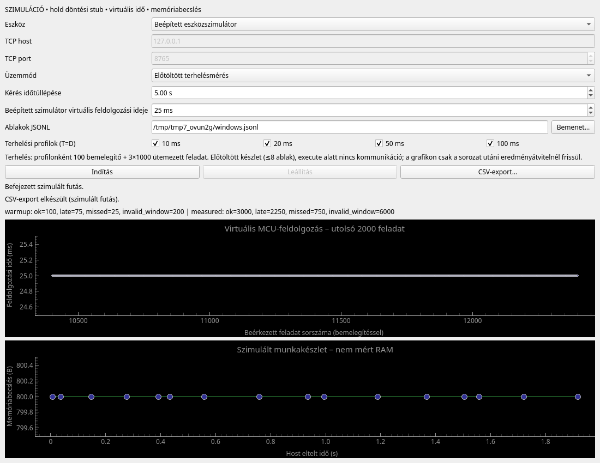

# #8 átadási ellenőrzés

Kiindulás: frissen fetch-elt `origin/main`,
`c3ef45dc77769b6c0a5012ab49c434bace425ddd`.
Külön worktree: `/tmp/edge-ai-issue8`, branch: `feat/issue-8-measurement-ui`.
Az eredeti worktree meglévő, nem követett dokumentuma nem módosult.

## Környezet és futtatás

Linux x86_64, Python 3.13, PySide6 6.12.0, pyqtgraph 0.14.0, NumPy 2.5.4.
Izolált `/tmp/issue8-venv` környezet; Qt `offscreen` platform.

```bash
QT_QPA_PLATFORM=offscreen UI_EVIDENCE_DIR=docs/verification/issue-8 \
  /tmp/issue8-venv/bin/python -m unittest discover -s tests -v
```

Eredmény: **41 teszt, 10,369 s, OK, nincs skip**.
[Teljes tesztnapló](issue-8/tests.txt).
A kezdeti sandboxos futtatás a helyi socketpár `sendall` műveletét
`PermissionError` hibával tiltotta; a végső futás engedélyezett, sandboxon
kívüli környezetben, valódi socketpárral és loopback TCP-vel történt.
Az offscreen platform `propagateSizeHints` üzenetei nem teszthibák.

## Bizonyítékok

| Ellenőrzés | Eredmény |
| --- | --- |
| Kiválasztás → indítás → élő grafikon → leállítás → CSV → újraindítás | Részleges run_stopped, nincs run_complete; új futás új run_id-val sikeres |
| Négy benchmarkprofil, 25 ms virtuális feldolgozás, egy jó és egy hibás ablak | 12400 eredmény, ebből 12000 mért + 400 bemelegítő |
| Mért sorozatok összesítése a fenti bemenettel | ok=3000, late=2250, missed=750, invalid_window=6000 |
| Bemelegítők összesítése | ok=100, late=75, missed=25, invalid_window=200 |
| Egyetlen 20 ms profil választása | 3100 eredmény, csak 20 ms period_ms |
| CSV visszaolvasás | Minden esemény JSON-tartalma és a fázis/profil/sorozat szerinti összesítés azonos; GUI-számlálók is azonosak |
| Benchmark kommunikációs sorrend | execute send → execute ack (uart_during_execution=false) → fetch → result; nincs execute közbeni grafikonadat |
| Timeout / kapcsolatvesztés / eszközhibaválasz | Látható hibás végállapot, run_failed és hibakód a CSV-ben, nincs hamis run_complete |
| Fájlolvasás és export mesterséges 250 ms késleltetéssel | A 10 ms-os GUI-timer mindkettő alatt több mint tízszer lefut |
| Exporthiba | Külön látható hiba, futási állapot megmarad |
| Leállítás függő socketolvasás közben, 30 s timeouttal | Bezárás aszinkron, run_stopped két másodpercen belül |
| Meglévő protokoll-/szabályreferencia-tesztek | Mind sikeres; a CLI két eredeti módja változatlanul lefut |



A képernyőkép a valódi widgetekből, az automatizált elfogadási folyamat végén
készült. A natív fájlválasztók útvonal-visszatérését a teszt helyettesíti;
a bemeneti fájlolvasás, exportírás és CSV-visszaolvasás tényleges.

## Ismert korlátok

- Nincs csatlakoztatott panel, UART-adapter vagy #4 integrációs bizonyíték.
  Csak szimulált idő/memória és simulator_stub döntés szerepel.
- Offscreen GUI-ellenőrzés történt; natív ablakkezelős kézi ellenőrzés nem.
- A teljes eseménynapló memóriában él az exportig, összeomláskor elveszhet.
  A nagy élő bemenet memóriaköltsége magas lehet.
- A grafikon 2000 feladatot tart meg; a CSV minden begyűjtött eredményt.
- Megszakításkor a be nem érkezett eredmények nem válnak kitalált missed
  rekordokká. A hiányos futás és a batch_start/count adatok megmaradnak;
  a valódi eszközoldali missed rekordok külön, változatlanul exportálódnak.

Visszafordítható GUI-hozzáadás; protokollverzió- vagy firmware-változás nincs.
